<p align="center">
  
</p>

<h1 align="center">Burrow</h1>

<p align="center">A calm, minimal terminal home for your coding agents on Windows.<br/><sub>Developed by MK</sub></p>

<p align="center">
  <a href="../../releases/latest"><b>Download for Windows</b></a> ·
  <a href="docs/burrow-demo.mp4"><b>Watch the film (1:18)</b></a>
</p>

<p align="center">
  <a href="docs/burrow-demo.mp4">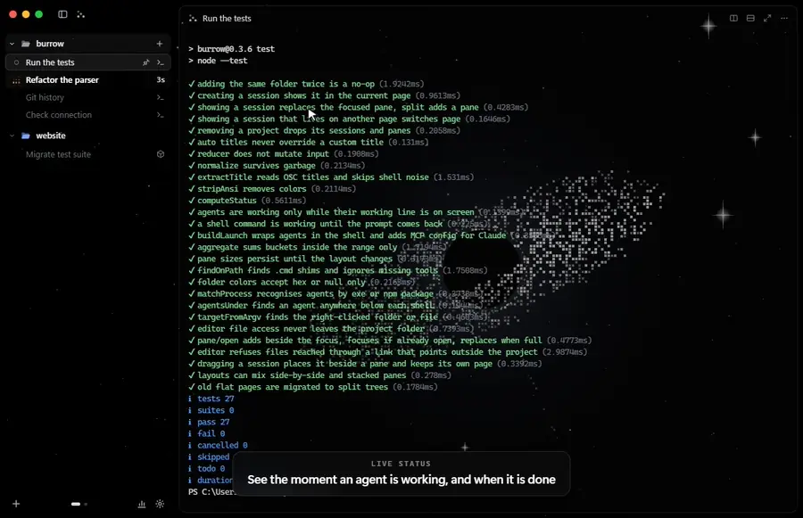</a>
  <br/><sub>Recorded from the real app. Click to watch the full film.</sub>
</p>

Run Claude Code, Codex, OpenCode, Gemini CLI, Kimi, Cursor Agent or a plain shell side by side, organised by project, in one black glass window. Burrow shows you which agent is working and when it's done, lets you lay panes out any way you like, and draws animated backgrounds behind it all.

## Highlights

- **Every agent, one window.** Projects on the left, real terminals on the right.
- **Knows when work is done.** Burrow reads each terminal's screen, so the working mark stops the moment an agent finishes.
- **Any layout.** Drag sessions into side-by-side and stacked panes, move and swap them, zoom one to full size.
- **Themes drawn in code.** Seven animated backgrounds, including a painting rendered as colored ASCII.
- **Small extras.** An editor with Markdown preview, a token-usage page, agent-to-agent messaging and auto-update.

## Themes

Pick one in **Settings → Theme**. They're drawn in code, light on the CPU, and pause when the window is minimized.

| | |
|---|---|
| 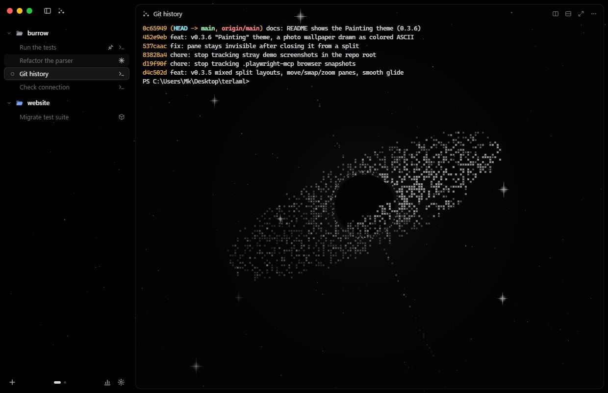 **Galaxy:** a black hole with drifting sparkles | 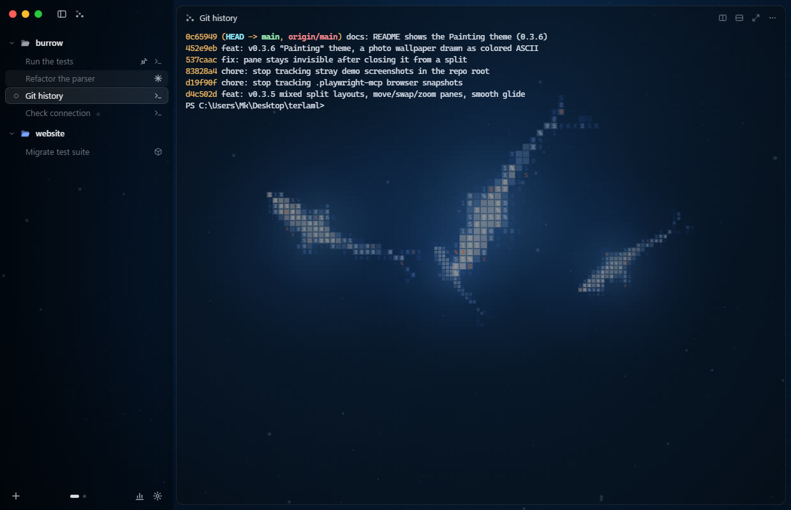 **Shark:** a school of glowing character-mosaic sharks |
| 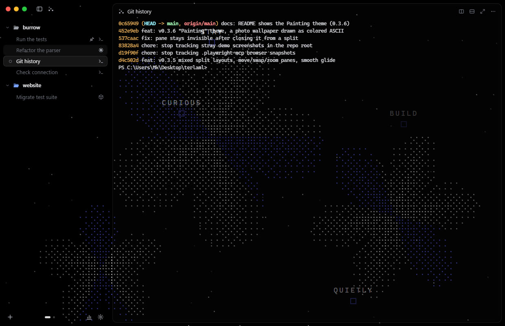 **Bloom:** dot-matrix flowers opening and closing | 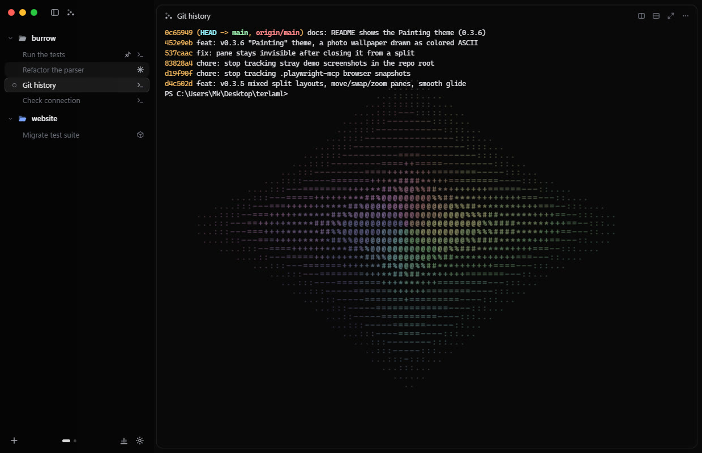 **Prism:** a turning pastel ASCII sphere |
| 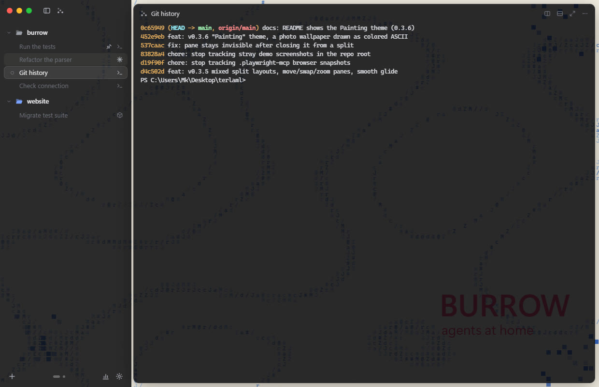 **Poster:** blue ASCII art on cream | 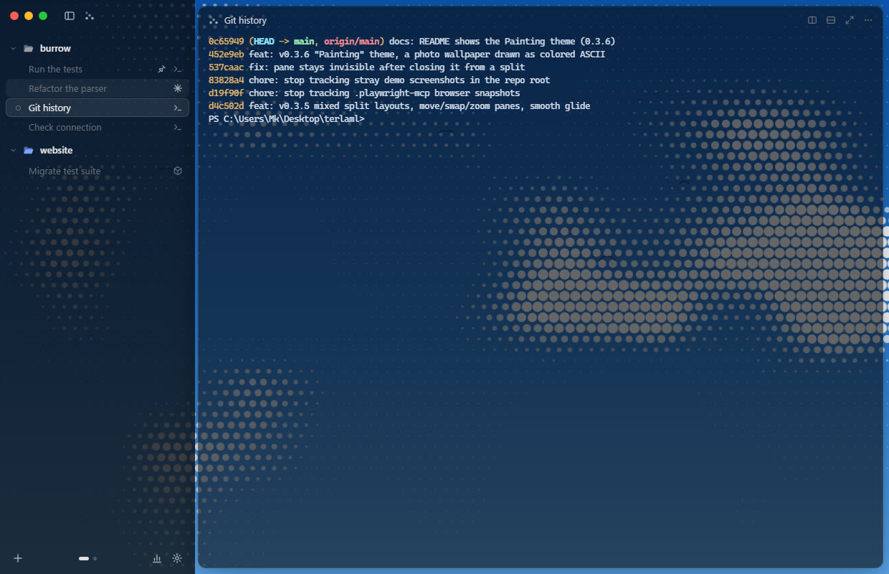 **Sky:** halftone clouds drifting across a blue sky |
| 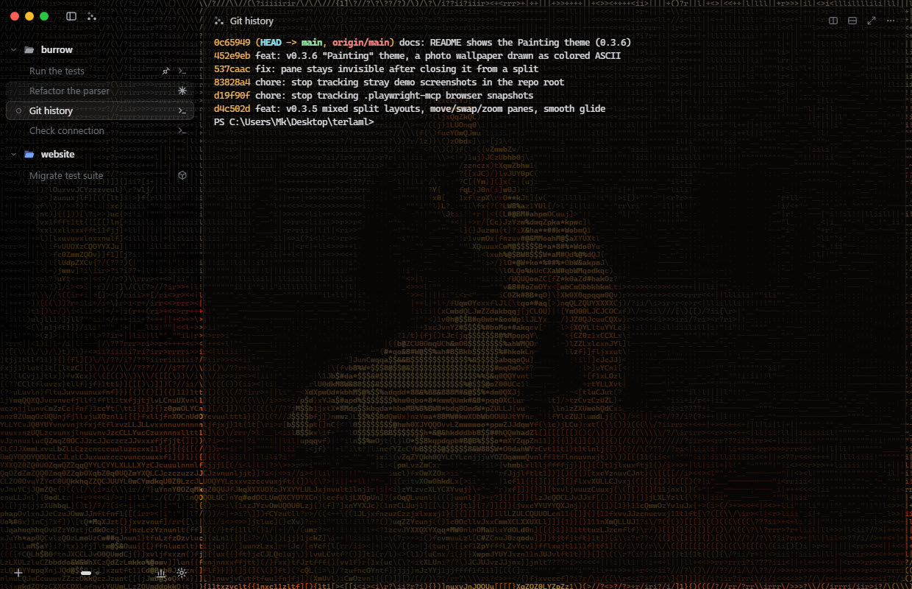 **Painting:** Repin's *Ivan the Terrible and His Son* (public domain) as colored ASCII. App colors follow the picture | **Glass:** no animation, just Windows 11 Acrylic or Mica blur |

## Layouts

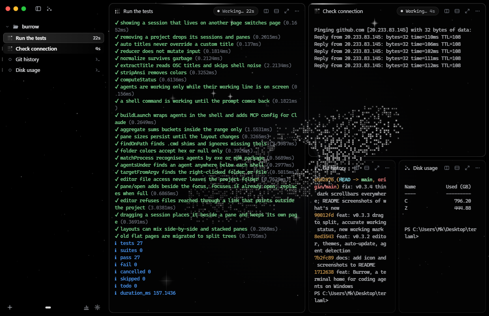

- **Drag to split:** drag a session from the sidebar onto any edge of any pane. A soft preview shows where it will land.
- **Mix directions:** side-by-side and stacked panes can mix, up to 6 per page.
- **Move and swap:** drag a pane by its title onto another pane's edge to move it, or onto its middle to swap the two.
- **Resize:** every divider resizes only its own group. Double-click a divider to even it out.
- **Smooth:** panes glide to their new place whenever the layout changes.
- **Zoom:** the ⤢ button or `Ctrl+Shift+Enter` grows one pane to full size, then puts it back.
- **Pages:** keep several layouts and switch with the dots or `Ctrl+Alt+← / →`. A session dragged onto another page also stays on its own.

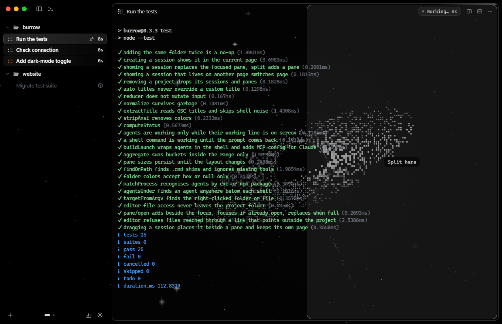

## Live status

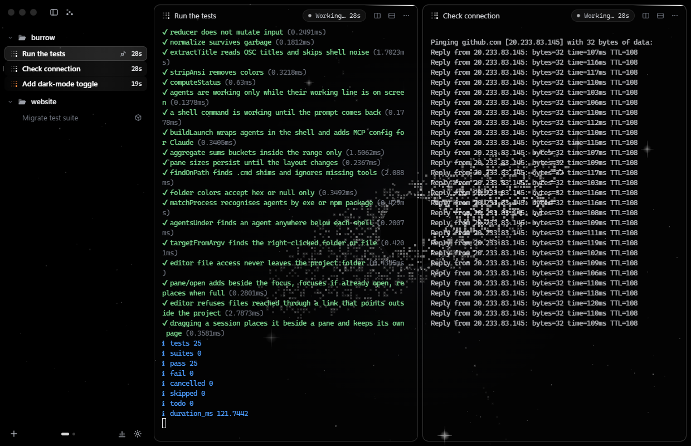

- **Working:** a 3×3 square of dots lit in a loop. It is orange for Claude Code and white for other agents, in the sidebar and in the pane title, with a `Working… 1m 12s` timer.
- **Accurate:** Burrow keeps a copy of what each terminal shows right now.
  - Claude Code, Codex, Gemini and OpenCode count as working only while their "esc to interrupt" line is visible.
  - Plain terminals count as working from Enter until the prompt comes back, so a quiet download still shows as running.
- **Needs you:** a pulsing badge when an agent waits for your approval.
- **Done:** a check when it finishes. Quiet, throttled notifications that you can turn off.

## Everything else

- **Projects & sessions:** add folders, start any agent inside them, pin, rename (double-click or F2), reorder and color folders.
- **Auto-detect agents:** Burrow sees which agent is really running in a terminal, and picks up newly installed CLIs.
- **Real terminals:** ConPTY and xterm.js with WebGL rendering, links, copy/paste and resume (`--continue`) after a restart.
- **Editor:** `Ctrl+Shift+F` opens any file as a card next to your agents. Markdown gets a live preview with clickable checkboxes, and the file reloads when an agent edits it.
- **Open in Burrow:** right-click a folder or file in Explorer.
- **Token usage:** a terminal-style page (`Ctrl+Shift+U`) that reads your Claude Code and Codex logs and shows totals, cache hit rate, per-day bars, projects, models and top sessions.
- **Agent-to-agent messaging (MCP):** every Claude Code session gets tools to list, read, message and start other sessions.
- **Auto-update:** new versions download in the background, so you can restart when you're ready.
- **Look:** black and white, Windows 11 Acrylic/Mica blur and smooth motion. A Motion setting keeps animations on, or follows Windows' *reduce motion*.


## Shortcuts

| Action | Keys |
|---|---|
| New session | `Ctrl+Shift+N` |
| Add project | `Ctrl+Shift+O` |
| Jump to session / commands | `Ctrl+Shift+P` |
| Toggle sidebar | `Ctrl+Shift+B` |
| Split right / down | `Ctrl+Shift+D` / `Ctrl+Shift+E` |
| Zoom pane | `Ctrl+Shift+Enter` |
| Move or swap a pane | drag its title |
| Close pane | `Ctrl+Shift+W` |
| Go to session 1–9 | `Ctrl+1…9` |
| Next / previous session | `Ctrl+Tab` / `Ctrl+Shift+Tab` |
| Switch page | `Ctrl+Alt+← / →` |
| Token usage | `Ctrl+Shift+U` |
| Open file (editor) | `Ctrl+Shift+F` |
| Save file / Markdown preview | `Ctrl+S` / `Ctrl+Shift+V` |
| Font size | `Ctrl+=` / `Ctrl+-` / `Ctrl+0` |
| Full screen | `F11` |
| Rename session | `F2` |
| Settings | `Ctrl+,` |

## Download

Get **Burrow-Setup.exe** from the [latest release](../../releases/latest) and run it. After that, Burrow updates itself (**Settings → Updates → Check now**).
Windows may show a SmartScreen warning because the installer isn't code-signed. Click **More info → Run anyway**.

## What's new

- **0.3.6:** the Painting theme. App colors are read from the picture. A closed split pane no longer comes up empty on its own page.
- **0.3.5:** mixed side-by-side and stacked layouts, move, swap and zoom panes, and a smooth glide on every layout change. "Working" no longer sticks when a prompt wraps.
- **0.3.4:** thin dark scrollbars everywhere.
- **0.3.3:** drag to split, accurate working status read from the screen, and the dot-square working mark.
- **0.3.2:** editor with Markdown preview, animated themes, auto-update and agent detection.

See all [releases](../../releases).

## Design

Love the look? [DESIGN.md](DESIGN.md) explains the whole style (colors, type, components, motion) with copy-paste CSS and Tailwind tokens for your own apps.

## Build from source

Requires Node.js 22+ on Windows 10/11.

```bash
git clone https://github.com/Mkhi1/burrow.git
cd burrow
npm install
npm start          # run the app
npm test           # run tests
npm run dist       # build the installer into dist/
```

## License

MIT. Developed by MK.
