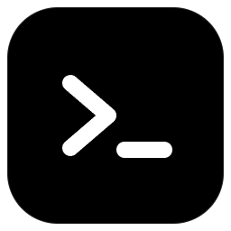
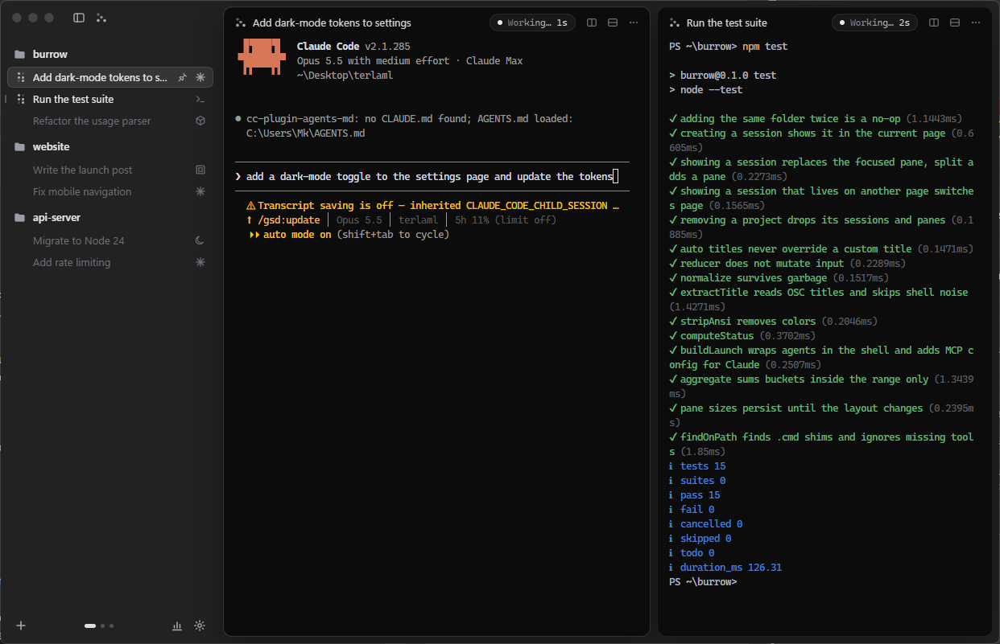
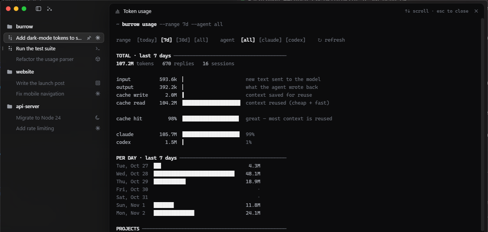

<p align="center">
  
</p>

<h1 align="center">Burrow</h1>

<p align="center">A calm, minimal terminal home for your coding agents on Windows.</p>

<p align="center">
  <a href="../../releases/latest"><b>Download for Windows</b></a>
</p>



Run Claude Code, Codex, OpenCode, Gemini CLI, Kimi, Cursor Agent or a plain shell side by side, organised by project, on a blurred black glass window.

## Download

Grab **Burrow Setup.exe** from the [latest release](../../releases/latest) and run it.
Windows may show a SmartScreen warning because the installer isn't code-signed. Click **More info → Run anyway**.

## Features

- **Projects & sessions:** add folders, start any agent inside them, pin, rename (double-click or F2) and reorder.
- **Live status:** an animated dot while an agent works, a pulsing dot when it needs your approval, and a dot when it finishes. Native notifications are throttled so they never spam.
- **Working timer:** shows `Working… 1m 12s` in the title bar while an agent runs.
- **Splits:** up to 4 panes per page, side by side or stacked. Drag the divider to resize, double-click to reset. Drag a session onto a pane to split.
- **Pages:** multiple layouts, switched with the dots or `Ctrl+Alt+← / →`.
- **Token usage:** a terminal-style page that reads your Claude Code and Codex logs. It shows totals, cache hit rate, per-day bars, projects, models and top sessions.
- **Agent-to-agent messaging (MCP):** every Claude Code session gets tools to list, read, message and start other sessions.
- **Auto-detect agents:** newly installed CLIs are picked up when you return to the window, or via **Check agents**.
- **Real terminals:** ConPTY + xterm.js with WebGL rendering, links, copy/paste and resume (`--continue`) after restart.
- **Look:** Windows 11 Acrylic/Mica blur, black and white theme, smooth motion (respects *reduce motion*).

## Token usage

A terminal-style page (`Ctrl+Shift+U`) that shows how many tokens your agents used, in plain words.



## Shortcuts

| Action | Keys |
|---|---|
| New session | `Ctrl+Shift+N` |
| Add project | `Ctrl+Shift+O` |
| Jump to session / commands | `Ctrl+Shift+P` |
| Toggle sidebar | `Ctrl+Shift+B` |
| Split right / down | `Ctrl+Shift+D` / `Ctrl+Shift+E` |
| Close pane | `Ctrl+Shift+W` |
| Go to session 1–9 | `Ctrl+1…9` |
| Next / previous session | `Ctrl+Tab` / `Ctrl+Shift+Tab` |
| Token usage | `Ctrl+Shift+U` |
| Font size | `Ctrl+=` / `Ctrl+-` / `Ctrl+0` |
| Full screen | `F11` |
| Rename session | `F2` |
| Settings | `Ctrl+,` |

## Build from source

Requires Node.js 22+ on Windows 10/11.

```bash
git clone https://github.com/Mkhi1/burrow.git
cd burrow
npm install
npm start          # run the app
npm test           # run tests
npm run dist       # build the installer into dist/
```

## License

MIT
